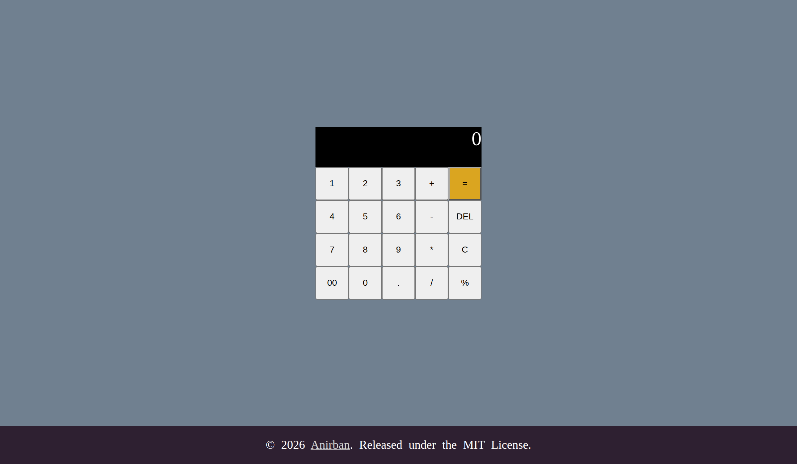

## Calculator

A Baisc calculator made from HTML, CSS and JavaScript.

Live demo:https://anirban185.github.io/Calculator/

## features

1) Add, subtract, multiply, divide and percentage
2) `C` to clear and `DEL` to delete the last digit
3) Shows Error when dividing by zero    

## How it works

The Calculator is a Display and a keypad split into 3 groups (numbers, operators and functions). The JS uses 3 Strign variables: current(being typed), previous(the first number) and operator.

Every button has a click listener that reads its text and updates these variables. Then when you press an operator it moves current into previous. Pressing = runs calculate() which first converts both numbers into math using switch and then does the math. And updateDisplay runs to refresh the display every time you click.

## Chalanges

Centring everything and getting everything into their proper position was very annoying so I had to Google how to centre a main or reposition the buttons but I still had to do trial and error until everything looked good.